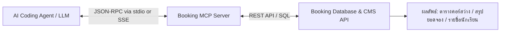
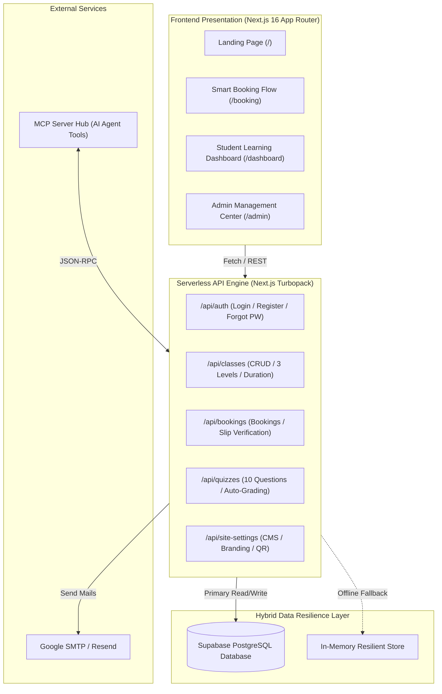
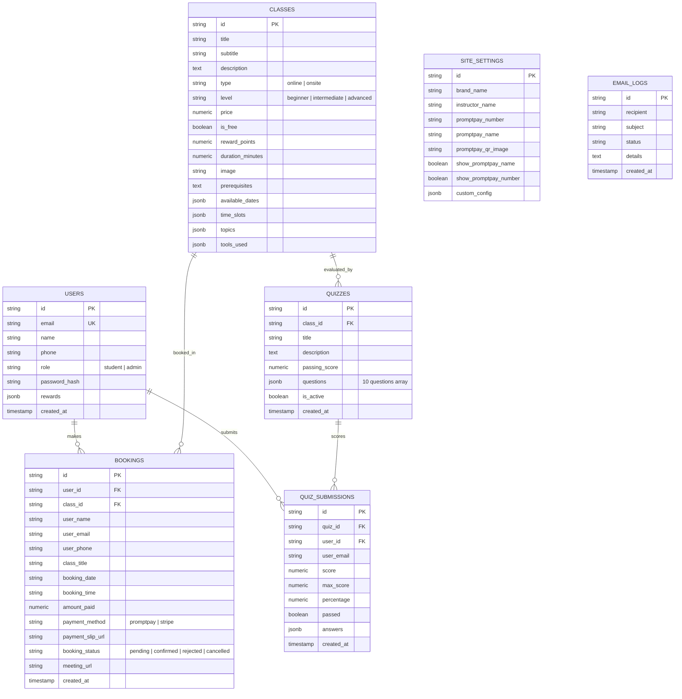

# Universal Class & Workshop Booking Platform — Master PRD & Implementation Skill Template

> **Template Type:** Reusable Full-Stack Class & Workshop Booking Blueprint  
> **Target Framework:** Next.js (App Router, Turbopack) · React · Tailwind CSS · Supabase PostgreSQL · Email SMTP · Vercel

---

## ⚡ Phase 0: Mandatory Onboarding Discovery (Interactive User Interview)

> [!IMPORTANT]
> **กฎเหล็กสำหรับ AI Agent ก่อนเริ่มสร้างระบบหรือเขียนโค้ด:**  
> Agent จะต้องถามและสรุป 5 คำถามตั้งต้นกับ User ให้ครบถ้วนก่อน เพื่อนำข้อมูลไปปรับแต่ง Configuration, Theme, และเนื้อหาของระบบ:

### 📋 แบบสอบถามตั้งต้น 5 ข้อ (5 Initialization Questions)

1. **ชื่อระบบ (System Name):**
   - แพลตฟอร์มหรือสถาบันการเรียนรู้ของคุณชื่ออะไร?
   - ข้อความ Tagline หรือคำโปรยหลักที่ต้องการแสดงบนส่วนหัวของเว็บไซต์คืออะไร?

2. **อัตลักษณ์แบรนด์ & โลโก้ (Branding & Identity):**
   - บุคลิกภาพของแบรนด์ (Tone of Voice): เช่น โมเดิร์นล้ำสมัย (Cyber/AI), ทางการพรีเมียม (Corporate/Luxury), สนุกสนานเข้าถึงง่าย (Playful/EdTech), หรือมินิมอลอบอุ่น (Minimal/Warm)
   - มีไฟล์โลโก้, ไอคอน, หรือต้องการให้ระบบสร้าง Mascot/Placeholder รูปแบบใด?

3. **ชุดสีหลักและธีม (Theme Color Palette & UI):**
   - ต้องการธีมสว่าง (Light Mode) หรือ ธีมมืด (Dark Slate/Navy Mode)?
   - สีหลัก (Primary Color): เช่น ทอง Amber (`#F59E0B`), ฟ้า Cyber Blue (`#3B82F6`), เขียวมรกต Emerald (`#10B981`), หรือ ม่วงนีออน Violet (`#8B5CF6`)
   - สีรอง/สีไฮไลต์ (Accent Color) สำหรับปุ่ม Action และการแจ้งเตือน

4. **ขอบเขตระบบขั้นแรก (MVP Scope):**
   - ฟังก์ชันหลักที่ต้องมีในวันเปิดตัว (Phase 1):
     - [ ] แคตตาล็อกคอร์สเรียน พร้อมตัวกรองระดับความยาก 3 ระดับ
     - [ ] ปฏิทินจองวันและรอบเวลาแบบล็อกวันเปิดสอนอัตโนมัติ (Date Auto-Lock)
     - [ ] บัตรชำระเงิน Thai QR PromptPay Voucher พร้อมระบบแนบสลิป
     - [ ] ระบบสมาชิกนักเรียน (แดชบอร์ดดูรอบเรียน, รับลิงก์ห้องเรียนสด, ดาวน์โหลดเอกสาร)
     - [ ] ระบบผู้ดูแลระบบ (Admin CMS) สำหรับตรวจสอบสลิป, อนุมัติการจอง, และจัดการคอร์ส
   - ฟังก์ชันเสริม (Phase 2):
     - [ ] ระบบแบบทดสอบประเมินผล 10 ข้อ (Post-Class Quiz) พร้อมตรวจผลและส่งอีเมลอัตโนมัติ
     - [ ] ระบบสะสมแต้ม Rewards แลกคอร์สฟรี
     - [ ] ระบบบล็อกบทความสไตล์ WordPress
     - [ ] คลัง Prompt & Studio เครื่องมือเสริม
     - [ ] MCP Server สำหรับให้อนุญาต AI Agents ดึงข้อมูลการจอง

5. **คอร์สเรียนเริ่มต้น 3 คอร์ส (3 Starter Courses):**
   - **คอร์สที่ 1 (ระดับเริ่มต้น - Beginner):**
     - ชื่อคอร์ส:
     - ประเภท: Onsite Workshop หรือ Online Live (Google Meet/Zoom)
     - รูปแบบราคา: เรียนฟรี (Free) หรือ มีค่าใช้จ่าย (ระบุจำนวนบาท)
     - ระยะเวลาเรียน: (เช่น 3 ชั่วโมง หรือ 1 วัน)
     - สิ่งที่ผู้เรียนจะได้รับ (Bullets 3-5 ข้อ):
   - **คอร์สที่ 2 (ระดับปานกลาง - Intermediate):**
     - ชื่อคอร์ส:
     - ประเภท: Onsite Workshop หรือ Online Live
     - รูปแบบราคา: (บาท)
     - ระยะเวลาเรียน:
     - สิ่งที่ผู้เรียนจะได้รับ:
   - **คอร์สที่ 3 (ระดับสูง - Advanced):**
     - ชื่อคอร์ส:
     - ประเภท: Onsite Workshop หรือ Online Live
     - รูปแบบราคา: (บาท)
     - ระยะเวลาเรียน:
     - สิ่งที่ผู้เรียนจะได้รับ:

---

## 🔌 Phase 1: การสอนและติดตั้ง MCP Server (Model Context Protocol Integration)

> [!TIP]
> **MCP (Model Context Protocol) คืออะไร และทำไมระบบ Booking ถึงต้องมี?**  
> MCP เป็นมาตรฐานเปิดที่อนุญาตให้ AI Assistants (เช่น Claude, Cursor, Antigravity) สามารถเรียกดูข้อมูลและสั่งการระบบจองคอร์สได้โดยตรงผ่าน Tools & Resources โดยที่ผู้ใช้ไม่ต้องเปิดเว็บเบราว์เซอร์



### 1.1 ประโยชน์ของ MCP Server สำหรับระบบ Booking
1. **AI Check Availability:** ให้ AI ตรวจสอบว่าคอร์สไหนยังมีที่นั่งว่างในวันใดได้ทันที
2. **AI Booking Assistance:** ผู้เรียนสามารถแชทกับ AI แล้วให้ AI ทำการสำรองที่นั่งในระบบได้
3. **Admin Automation:** แอดมินสั่ง AI ให้สรุปยอดการจองประจำวัน หรือตรวจสอบสลิปโอนเงินค้างตรวจได้ผ่าน Prompt เดียว

### 1.2 ตัวอย่างโค้ดการสร้าง Booking MCP Server (Node.js / TypeScript)

```typescript
// server.ts - Booking Model Context Protocol Server
import { Server } from "@modelcontextprotocol/sdk/server/index.js";
import { StdioServerTransport } from "@modelcontextprotocol/sdk/server/stdio.js";
import {
  CallToolRequestSchema,
  ListToolsRequestSchema,
} from "@modelcontextprotocol/sdk/types.js";

const server = new Server(
  {
    name: "booking-class-mcp",
    version: "1.0.0",
  },
  {
    capabilities: {
      tools: {},
    },
  }
);

// 1. กำหนดรายชื่อ Tools ที่ AI สามารถเรียกใช้งานได้
server.setRequestHandler(ListToolsRequestSchema, async () => {
  return {
    tools: [
      {
        name: "list_available_classes",
        description: "ดึงรายการคอร์สเรียนทั้งหมด พร้อมระดับความยากและที่นั่งว่าง",
        inputSchema: {
          type: "object",
          properties: {
            level: {
              type: "string",
              enum: ["beginner", "intermediate", "advanced", "all"],
              description: "กรองตามระดับความยากของคอร์ส",
            },
          },
        },
      },
      {
        name: "check_class_schedule",
        description: "ตรวจสอบวันที่และรอบเวลาเปิดสอนของคอร์สที่ระบุ",
        inputSchema: {
          type: "object",
          properties: {
            classId: { type: "string", description: "รหัสคอร์สเรียน" },
          },
          required: ["classId"],
        },
      },
      {
        name: "get_booking_summary",
        description: "สรุปรายการจองล่าสุดสำหรับแอดมิน (สิทธิ์ Admin)",
        inputSchema: {
          type: "object",
          properties: {
            status: {
              type: "string",
              enum: ["pending", "confirmed", "all"],
              description: "สถานะการจองที่ต้องการดู",
            },
          },
        },
      },
    ],
  };
});

// 2. จัดการคำสั่งและเชื่อมต่อกับฐานข้อมูลระบบ
server.setRequestHandler(CallToolRequestSchema, async (request) => {
  const { name, arguments: args } = request.params;
  const baseUrl = process.env.API_BASE_URL || "http://localhost:3000";

  if (name === "list_available_classes") {
    const res = await fetch(`${baseUrl}/api/classes`);
    const json = await res.json();
    let classes = json.data || [];
    if (args?.level && args.level !== "all") {
      classes = classes.filter((c: any) => c.level === args.level);
    }
    return {
      content: [
        {
          type: "text",
          text: JSON.stringify(
            classes.map((c: any) => ({
              id: c.id,
              title: c.title,
              level: c.level,
              price: c.isFree ? "ฟรี (0 บาท)" : `${c.price} บาท`,
              duration: `${c.durationValue || 3} ${c.durationUnit || "hour"}`,
            })),
            null,
            2
          ),
        },
      ],
    };
  }

  if (name === "check_class_schedule") {
    const res = await fetch(`${baseUrl}/api/classes/${args?.classId}`);
    const json = await res.json();
    const c = json.data;
    return {
      content: [
        {
          type: "text",
          text: JSON.stringify(
            {
              title: c?.title,
              availableDates: c?.availableDates,
              timeSlots: c?.timeSlots,
            },
            null,
            2
          ),
        },
      ],
    };
  }

  throw new Error(`Tool not found: ${name}`);
});

// เริ่มต้น Transport
async function run() {
  const transport = new StdioServerTransport();
  await server.connect(transport);
}
run().catch(console.error);
```

### 1.3 การตั้งค่า Config ให้ AI Tools ใช้งาน MCP
เพิ่มการตั้งค่าในไฟล์คอนฟิก (เช่น `claude_desktop_config.json` หรือ `antigravity.mcp.json`):
```json
{
  "mcpServers": {
    "booking-class-system": {
      "command": "node",
      "args": ["/path/to/mcp-server/build/index.js"],
      "env": {
        "API_BASE_URL": "http://localhost:3000"
      }
    }
  }
}
```

---

## 🏗️ Phase 2: System Architecture & Technical Specifications



### 2.1 สถาปัตยกรรมข้อมูลสำรอง 2 ชั้น (Data Resilience)
- **ชั้นหลัก (Primary):** Supabase PostgreSQL ผ่าน `@supabase/supabase-js` พร้อมเปิดใช้งาน Row Level Security (RLS)
- **ชั้นสำรอง (Safe Fallback):** มี In-Memory Store รองรับกรณีไม่สามารถเชื่อมต่อฐานข้อมูลได้ ทำให้เว็บไม่แสดงหน้า Error 500
- **Metadata Encoding Pattern:** ข้อมูลฟิลด์ส่วนขยาย (เช่น ระดับความยาก `level`, ระยะเวลา `duration`, คอร์สฟรี `isFree`, เอกสารแนบ `attachments`) จะถูกบันทึกผ่าน Metadata Tag ในฟิลด์ `prerequisites` เพื่อให้เข้ากันได้กับฐานข้อมูลเดิม 100%:
  ```text
  <!--level:beginner-->
  <!--duration:3:hour-->
  <!--isFree:false-->
  <!--rewardPoints:150-->
  <!--attachments:[{"id":"att-1","name":"Course Slide","type":"pdf","url":"..."}]-->
  ```

---

## 🗄️ Phase 3: Core Database Schema (Entity-Relationship)



---

## 📡 Phase 4: Standard REST API Contracts

| Method | Endpoint | Access Level | Description | Payload / Query |
| :--- | :--- | :--- | :--- | :--- |
| `POST` | `/api/auth` | Public | สมัครสมาชิก / ล็อกอิน | `{ action: 'login'\|'register', email, password, name, phone }` |
| `POST` | `/api/auth/forgot-password` | Public | ขอลิงก์/รีเซ็ตรหัสผ่าน | `{ action: 'request'\|'reset', email, resetToken, newPassword }` |
| `GET` | `/api/classes` | Public | ดึงรายการคอร์สทั้งหมด | รองรับ query filter ตาม level |
| `POST` | `/api/classes` | Admin | สร้างคลาสเรียนใหม่ | Payload: `ClassItem` (รวม level 3 ระดับ, duration, isFree) |
| `PUT` | `/api/classes/[id]` | Admin | แก้ไขคลาสเรียน | Payload: Partial `ClassItem` |
| `DELETE` | `/api/classes/[id]` | Admin | ลบคลาสเรียน | Param: `id` |
| `GET` | `/api/bookings` | User / Admin | ดึงประวัติการจอง | `?userEmail=...` (นักเรียน) หรือทั้งหมด (แอดมิน) |
| `POST` | `/api/bookings` | Public / User | ส่งคำขอจองคลาสเรียน | `{ classId, userName, userEmail, userPhone, date, timeSlot, slipUrl }` |
| `PUT` | `/api/bookings/[id]` | Admin | อัปเดตสถานะ / แนบ Meet | `{ bookingStatus, meetingUrl, rescheduleDate, rescheduleTime }` |
| `DELETE` | `/api/bookings/[id]` | Admin | ลบรายการจองคลาสเรียน | Param: `id` |
| `GET` | `/api/quizzes` | User / Admin | ดึงข้อสอบประจำคลาส | `?classId=...` |
| `POST` | `/api/quizzes/submit` | Student | ส่งข้อสอบ 10 ข้อ | `{ quizId, answers: Record<string, string>, userEmail }` |
| `GET` | `/api/admin/quizzes` | Admin | สรุปผลสอบนักเรียน | คืนค่า `{ quizzes: [], submissions: [] }` |
| `POST` | `/api/admin/quizzes/resend-email` | Admin | กดส่งอีเมลผลสอบซ้ำ | `{ submissionId }` |
| `GET` / `PUT`| `/api/site-settings` | Public / Admin | ดึง/บันทึกการตั้งค่าเว็บ | Payload: `SiteSettings` (QR image, branding, switches) |
| `POST` | `/api/upload` | User / Admin | อัปโหลดรูปภาพ / สลิป | Multipart form data -> Base64 URL / Storage path |

---

## 🎨 Phase 5: Core Functional Modules & Business Rules

### 5.1 ระบบคอร์สเรียน & ระดับความยาก 3 ระดับ (Course & Level System)
- **3 ระดับความยาก:**
  1. `beginner` (ระดับเริ่มต้น): ไม่มีพื้นฐานก็เรียนได้ เริ่มต้นจากศูนย์ (Badge สีเขียว Emerald)
  2. `intermediate` (ระดับปานกลาง): มีพื้นฐานมาบ้าง มุ่งเน้นต่อยอดทำงานจริง (Badge สีเหลือง Amber)
  3. `advanced` (ระดับสูง): เทคนิคเชิงลึก สถาปัตยกรรมระดับแอดวานซ์ (Badge สีแดงกุหลาบ Rose)
- **ระบบระยะเวลา (Duration Manager):** ป้อนตัวเลข + เลือกหน่วยอิสระ:
  - `hour` (ชั่วโมง)
  - `minute` (นาที)
  - `day` (วัน)
- **ระบบราคา (Pricing Modes):**
  - คอร์สฟรี (`isFree: true`): ราคา 0 บาท, ป้ายกำกับ "เรียนฟรี (FREE)", ปุ่ม "ลงทะเบียนเรียนฟรี"
  - คอร์สมีค่าใช้จ่าย (`isFree: false`): แสดงราคาปกติ พร้อมจำนวนแต้มสะสมที่จะได้รับ

### 5.2 ระบบจองคอร์ส & ชำระเงิน PromptPay (Smart Booking Flow)
- **Smart Calendar Lock:** เมื่อเลือกคลาส ปฏิทินจะเปิดให้คลิกเลือกได้เฉพาะวันที่และรอบเวลาที่คลาสนั้นเปิดสอน ป้องกันการเลือกวันผิดพลาด
- **Thai QR PromptPay Voucher:** บัตรชำระเงินมาตรฐาน มีปุ่มดาวน์โหลดรูป QR และปุ่มคัดลอกเบอร์โทร/เลขบัญชีพร้อมฟีดแบ็กทันที
- **Admin Visibility Toggles:** แอดมินสามารถเปิด/ปิดการแสดงผลชื่อบัญชี และหมายเลขพร้อมเพย์ได้จากหน้า Site CMS พร้อม Live Preview

### 5.3 ระบบประเมินผล 10 ข้อ (Post-Class Evaluation)
- แบบทดสอบ 10 ข้อ ช้อยส์ 4 ตัวเลือก (A, B, C, D)
- ตรวจและคิดคะแนนทันที (Passing threshold >= 70%)
- หากสอบผ่าน: แสดง Confetti พลุฉลองบนหน้าจอ
- ส่งอีเมล HTML รายงานสรุปคะแนนไปยังผู้เรียนอัตโนมัติ พร้อมสถิติจำนวนข้อที่ตอบถูก

### 5.4 มาตรการความปลอดภัยและ Anti-Spam
- บล็อคอีเมลรูปแบบขยะหรือโดเมนชั่วคราว (Disposable) และบล็อคอีเมลลงท้ายด้วย `@example.com` ทุกกรณี
- รหัสผ่านผู้ใช้ต้องมีความยาวขั้นต่ำ 8 ตัวอักษร ผสมตัวอักษรและตัวเลข
- ตรวจสอบสิทธิ์ผู้ดูแลระบบ (`role === 'admin'`) ก่อนเข้าถึงหน้า `/admin` และ API แอดมิน

---

## 🚀 Phase 6: Deployment & Checklist

### รายการตัวแปร Environment Variables (`.env.local`):
```ini
# Supabase Configuration
NEXT_PUBLIC_SUPABASE_URL=https://[YOUR_SUPABASE_PROJECT].supabase.co
NEXT_PUBLIC_SUPABASE_ANON_KEY=[YOUR_SUPABASE_ANON_KEY]
SUPABASE_SERVICE_ROLE_KEY=[YOUR_SUPABASE_SERVICE_ROLE_KEY]

# Email SMTP Server
SMTP_HOST=smtp.gmail.com
SMTP_PORT=465
SMTP_SECURE=true
SMTP_USER=[YOUR_SMTP_USER_EMAIL]
SMTP_PASS=[YOUR_SMTP_APP_PASSWORD]
SMTP_FROM="[YOUR_PLATFORM_NAME] <[YOUR_SMTP_USER_EMAIL]>"

# Application URL
NEXT_PUBLIC_APP_URL=https://[YOUR_PRODUCTION_DOMAIN]
```

### คำสั่งตรวจสอบและ Deploy:
```bash
# 1. ทดสอบคอมไพล์โค้ดและ Type-checking
npm run build

# 2. Deploy ขึ้นระบบ Production
npx vercel --prod
```
