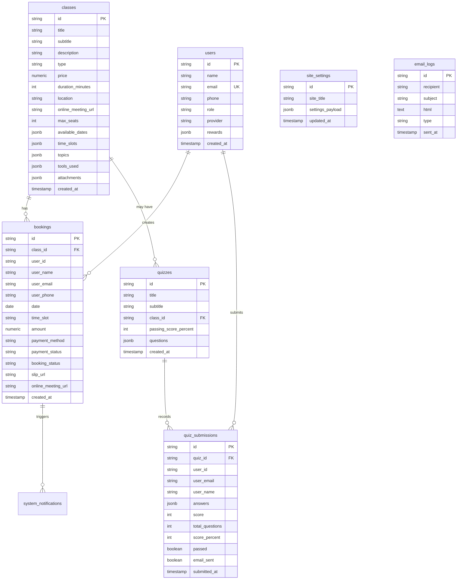

# โครงสร้างฐานข้อมูล (Database Schema)
## Supabase PostgreSQL Schema Specification

เอกสารระบุรายละเอียดตารางข้อมูลทั้งหมด ฟิลด์ ประเภทข้อมูล และนโยบายความปลอดภัยระดับแถว (Row Level Security - RLS)

---

## 1. ภาพรวมตาราง (Entity Relationship Diagram)



---

## 2. รายละเอียดตารางและคอลัมน์ (Table Specifications)

### 2.1 ตาราง `classes` (คลาสและหลักสูตรอบรม)
เก็บข้อมูลคลาสเรียนทั้ง Onsite และ Online
| Column | Type | Constraints | คำอธิบาย |
| :--- | :--- | :--- | :--- |
| `id` | `TEXT` | PRIMARY KEY | รหัสอ้างอิงของคลาส (เช่น `ai-content-workshop`) |
| `title` | `TEXT` | NOT NULL | ชื่อหลักสูตร |
| `subtitle` | `TEXT` | | คำโปรยสั้น |
| `description` | `TEXT` | | รายละเอียดเนื้อหา |
| `type` | `TEXT` | CHECK (`online`, `onsite`) | รูปแบบการเรียน |
| `price` | `NUMERIC(10,2)` | NOT NULL DEFAULT 0 | ราคาค่าเรียน (บาท) |
| `duration_minutes` | `INTEGER` | NOT NULL DEFAULT 120 | ระยะเวลาเรียน (นาที) |
| `location` | `TEXT` | | สถานที่จัดอบรม (กรณี Onsite) |
| `online_meeting_url`| `TEXT` | | ลิงก์ห้องเรียน Google Meet / Zoom |
| `max_seats` | `INTEGER` | DEFAULT 20 | จำนวนที่นั่งสูงสุด |
| `available_dates` | `JSONB` | DEFAULT '[]' | วันที่เปิดสอน Array เช่น `["2026-11-01", ...]` |
| `time_slots` | `JSONB` | DEFAULT '[]' | รอบเวลาเรียน เช่น `["13:00 - 16:00"]` |
| `topics` | `JSONB` | DEFAULT '[]' | หัวข้อการเรียนรู้ |
| `tools_used` | `JSONB` | DEFAULT '[]' | เครื่องมือ AI ที่ใช้ในคลาส |
| `attachments` | `JSONB` | DEFAULT '[]' | เอกสารประกอบ (PDF, Slide, วิดีโอ ไม่เกิน 4 ไฟล์) |
| `image` | `TEXT` | | รูปภาพโปสเตอร์คอร์ส |
| `featured` | `BOOLEAN` | DEFAULT false | ปักหมุดหน้าแรกหรือไม่ |
| `created_at` | `TIMESTAMPTZ` | DEFAULT now() | วันที่สร้าง |

---

### 2.2 ตาราง `bookings` (รายการจองคลาส)
เก็บประวัติการจองและสถานะการชำระเงิน
| Column | Type | Constraints | คำอธิบาย |
| :--- | :--- | :--- | :--- |
| `id` | `TEXT` | PRIMARY KEY | รหัสการจอง เช่น `BKG-1729000000` |
| `class_id` | `TEXT` | REFERENCES classes(id) | รหัสคลาสที่จอง |
| `class_title` | `TEXT` | NOT NULL | ชื่อคลาส ณ ตอนที่จอง |
| `class_type` | `TEXT` | CHECK (`online`, `onsite`) | ประเภทคลาส |
| `date` | `DATE` | NOT NULL | วันที่ผู้เรียนเลือกจอง |
| `time_slot` | `TEXT` | NOT NULL | ช่วงเวลาที่เลือก |
| `user_id` | `TEXT` | | รหัสผู้ใช้งาน (ถ้าล็อกอิน) |
| `user_name` | `TEXT` | NOT NULL | ชื่อ-นามสกุลผู้เรียน |
| `user_email` | `TEXT` | NOT NULL | อีเมลผู้เรียน |
| `user_phone` | `TEXT` | NOT NULL | เบอร์โทรศัพท์ |
| `line_id` | `TEXT` | | Line ID สำหรับติดต่อ |
| `amount` | `NUMERIC(10,2)` | NOT NULL | ยอดเงินที่ต้องชำระ |
| `payment_method` | `TEXT` | CHECK (`promptpay_qr`, `stripe`) | วิธีชำระเงิน |
| `payment_status` | `TEXT` | CHECK (`pending`, `verified`, `failed`) | สถานะสลิป |
| `slip_url` | `TEXT` | | ลิงก์หรือ Base64 สลิปการโอนเงิน |
| `booking_status` | `TEXT` | CHECK (`pending_payment`, `confirmed`, `rejected`, `cancelled`, `completed`) | สถานะการจอง |
| `online_meeting_url`| `TEXT` | | ลิงก์ห้องเรียนที่ส่งให้นักเรียน |
| `reject_reason` | `TEXT` | | สาเหตุการปฏิเสธ (กรณีสลิปไม่ถูกต้อง) |
| `notes` | `TEXT` | | บันทึกเพิ่มเติม หรือ Flag เช่น `__DELETED__` |
| `created_at` | `TIMESTAMPTZ` | DEFAULT now() | วันเวลาที่ทำรายการ |

---

### 2.3 ตาราง `quizzes` (แบบทดสอบและแบบประเมิน)
| Column | Type | Constraints | คำอธิบาย |
| :--- | :--- | :--- | :--- |
| `id` | `TEXT` | PRIMARY KEY | รหัสชุดข้อสอบ เช่น `quiz-ai-content` |
| `title` | `TEXT` | NOT NULL | ชื่อแบบประเมิน |
| `subtitle` | `TEXT` | | คำอธิบายเพิ่มเติม |
| `class_id` | `TEXT` | | ผูกกับคลาสเรียนใด (หรือปล่อยว่างเป็นข้อสอบรวม) |
| `passing_score_percent` | `INTEGER` | DEFAULT 70 | เกณฑ์คะแนนขั้นต่ำในการผ่าน (%) |
| `questions` | `JSONB` | NOT NULL | รายการคำถาม 10 ข้อพร้อม Choice A-D และเฉลย |
| `created_at` | `TIMESTAMPTZ` | DEFAULT now() | วันที่สร้าง |

**โครงสร้างข้อมูลในคอลัมน์ `questions` (JSONB):**
```json
[
  {
    "id": "q1",
    "question": "โมเดลใดเหมาะสมที่สุดสำหรับการวิเคราะห์เอกสารยาวและโค้ดระดับลึก?",
    "options": ["ChatGPT 3.5", "Claude 3.7 Sonnet / Opus", "Gemini Nano", "Siri"],
    "correctOptionIndex": 1,
    "explanation": "Claude 3.7 มีขีดความสามารถการคิดวิเคราะห์เชิงลึกและรองรับ Context Window ขนาดยาวเป็นเลิศ"
  }
]
```

---

### 2.4 ตาราง `quiz_submissions` (ผลการสอบของนักเรียน)
| Column | Type | Constraints | คำอธิบาย |
| :--- | :--- | :--- | :--- |
| `id` | `TEXT` | PRIMARY KEY | รหัสการส่งข้อสอบ |
| `quiz_id` | `TEXT` | NOT NULL | รหัสชุดข้อสอบ |
| `user_email` | `TEXT` | NOT NULL | อีเมลผู้ทำแบบทดสอบ |
| `user_name` | `TEXT` | NOT NULL | ชื่อผู้ทำแบบทดสอบ |
| `answers` | `JSONB` | NOT NULL | คำตอบที่ผู้เรียนเลือก เช่น `[1, 0, 2, ...]` |
| `score` | `INTEGER` | NOT NULL | จำนวนข้อที่ตอบถูก (เช่น 9) |
| `total_questions`| `INTEGER` | NOT NULL | จำนวนข้อทั้งหมด (เช่น 10) |
| `score_percent` | `INTEGER` | NOT NULL | เปอร์เซ็นต์คะแนน (เช่น 90) |
| `passed` | `BOOLEAN` | NOT NULL | ผ่านเกณฑ์หรือไม่ |
| `email_sent` | `BOOLEAN` | DEFAULT false | ส่งผลสรุปทางอีเมลแล้วหรือไม่ |
| `submitted_at` | `TIMESTAMPTZ` | DEFAULT now() | วันเวลาที่ส่งข้อสอบ |

---

### 2.5 ตาราง `site_settings` (การตั้งค่าระบบ & หน้าเว็บ)
| Column | Type | Constraints | คำอธิบาย |
| :--- | :--- | :--- | :--- |
| `id` | `TEXT` | PRIMARY KEY DEFAULT 'current_site_settings' | Single-row configuration |
| `site_title` | `TEXT` | | ชื่อเว็บไซต์ |
| `settings_payload` | `JSONB` | NOT NULL | ข้อมูลตั้งค่าทั้งหมด (PromptPay toggles, Branding, Hero text) |
| `updated_at` | `TIMESTAMPTZ` | DEFAULT now() | วันที่แก้ไขล่าสุด |

---

### 2.6 ตาราง `email_logs` (ประวัติการส่งอีเมล)
| Column | Type | Constraints | คำอธิบาย |
| :--- | :--- | :--- | :--- |
| `id` | `TEXT` | PRIMARY KEY | รหัสบันทึกอีเมล |
| `recipient` | `TEXT` | NOT NULL | ที่อยู่อีเมลผู้รับ |
| `subject` | `TEXT` | NOT NULL | หัวข้ออีเมล |
| `html` | `TEXT` | NOT NULL | เนื้อหา HTML ที่ส่งออกไป |
| `type` | `TEXT` | | ชนิดของอีเมล เช่น `user_confirmation`, `quiz_result` |
| `sent_at` | `TIMESTAMPTZ` | DEFAULT now() | วันเวลาที่ส่งออก |

---

## 3. นโยบายความปลอดภัย RLS (Row Level Security)

```sql
-- เปิดใช้งาน RLS บนทุกตาราง
ALTER TABLE public.classes ENABLE ROW LEVEL SECURITY;
ALTER TABLE public.bookings ENABLE ROW LEVEL SECURITY;
ALTER TABLE public.users ENABLE ROW LEVEL SECURITY;
ALTER TABLE public.quizzes ENABLE ROW LEVEL SECURITY;
ALTER TABLE public.quiz_submissions ENABLE ROW LEVEL SECURITY;
ALTER TABLE public.site_settings ENABLE ROW LEVEL SECURITY;
ALTER TABLE public.email_logs ENABLE ROW LEVEL SECURITY;

-- สิทธิ์การเข้าถึง Classes (เปิดให้อ่านสาธารณะ แก้ไขได้เมื่อมีสิทธิ์)
CREATE POLICY "Public Read Classes" ON public.classes FOR SELECT USING (true);
CREATE POLICY "Admin Modify Classes" ON public.classes FOR ALL USING (true);

-- สิทธิ์การเข้าถึง Bookings
CREATE POLICY "Public Read Bookings" ON public.bookings FOR SELECT USING (true);
CREATE POLICY "Public Insert Bookings" ON public.bookings FOR INSERT WITH CHECK (true);
CREATE POLICY "Admin Update Bookings" ON public.bookings FOR UPDATE USING (true);
CREATE POLICY "Admin Delete Bookings" ON public.bookings FOR DELETE USING (true);

-- สิทธิ์การเข้าถึง Quizzes & Submissions
CREATE POLICY "Public Read Quizzes" ON public.quizzes FOR SELECT USING (true);
CREATE POLICY "Public Insert Submissions" ON public.quiz_submissions FOR INSERT WITH CHECK (true);
CREATE POLICY "Public Read Submissions" ON public.quiz_submissions FOR SELECT USING (true);
```
