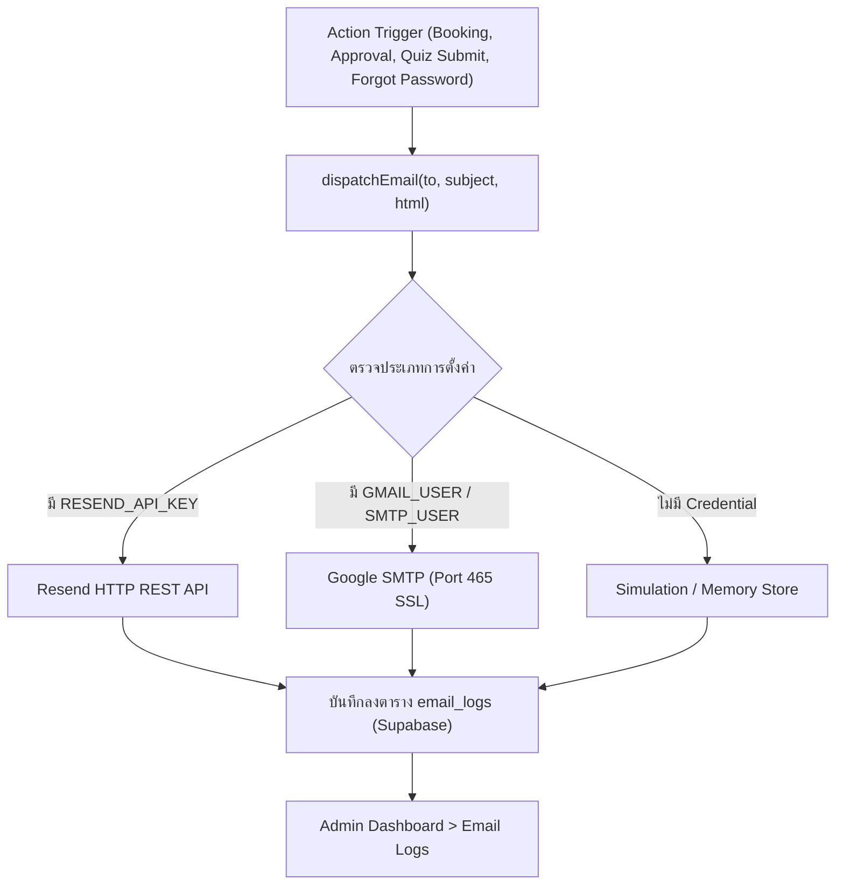

# ระบบแจ้งเตือนทางอีเมล (Email Notification Engine)
## Nodemailer SMTP & Automated Dispatch System

เอกสารนี้อธิบายการทำงานของระบบอีเมล เทมเพลต HTML การตั้งค่า Google SMTP และการบันทึก Log การส่งอีเมลทั้งหมด

---

## 1. การทำงานของระบบอีเมล (Architecture)

ระบบอีเมลใช้ `nodemailer` ทำงานร่วมกับ Google SMTP หรือ Resend API โดยมีระบบ Fallback ไปยัง In-Memory Log หากไม่ได้กำหนดค่า Credential



---

## 2. การตั้งค่าสิ่งแวดล้อม (Environment Variables)

ตั้งค่าตัวแปรในไฟล์ `.env.local` หรือบน Vercel Dashboard:

```env
# ตั้งค่า Google Gmail SMTP
SMTP_HOST=smtp.gmail.com
SMTP_PORT=465
SMTP_USER=your_email@gmail.com
SMTP_PASS=xxxx xxxx xxxx xxxx    # รหัสผ่านแอป (Google App Password 16 หลัก)
EMAIL_FROM="อ. Kevin AI Studio <your_email@gmail.com>"

# หรือใช้ Resend (ทางเลือกเสริม)
# RESEND_API_KEY=re_123456789
```

> **ข้อแนะนำ:** หากใช้ Gmail ต้องเปิดใช้งาน **2-Step Verification** ในบัญชี Google ก่อน แล้วสร้าง **App Password (รหัสผ่านสำหรับแอป)** 16 หลักมาใส่ใน `SMTP_PASS`

---

## 3. รายการเทมเพลตอีเมลทั้งหมด (Email Templates)

| ฟังก์ชัน | ผู้รับ | สถานการณ์ที่ส่ง | ข้อมูลในอีเมล |
| :--- | :--- | :--- | :--- |
| `sendAdminNewBookingAlert` | แอดมิน / ผู้สอน | นักเรียนส่งคำขอจองคลาสใหม่ | รหัสจอง, ชื่อคอร์ส, วันเวลา, ผู้เรียน, ลิงก์สลิป |
| `sendBookingConfirmation` | นักเรียน | เมื่อนักเรียนกดจองคอร์สสำเร็จ | สรุปรายละเอียดการจอง และแจ้งรอตรวจสอบสลิป |
| `sendBookingApprovedEmail` | นักเรียน | แอดมินกดอนุมัติการจอง | ลิงก์เข้าห้องเรียน Google Meet / สถานที่จัดงาน, เอกสารดาวน์โหลด |
| `sendBookingRejectedEmail` | นักเรียน | สลิปไม่ถูกต้อง / คลาสเต็ม | สาเหตุที่ปฏิเสธ พร้อมช่องทางติดต่อแอดมิน |
| `sendBookingRescheduledEmail` | นักเรียน | มีการปรับเปลี่ยนวันหรือเวลาเรียน | วันเวลาใหม่ที่นัดหมาย พร้อมเหตุผล |
| `sendPasswordResetEmail` | นักเรียน | กดลืมรหัสผ่าน หรือแอดมินรีเซ็ตให้ | รหัสผ่านชั่วคราวใหม่ (Temporary Password) |
| `sendQuizResultEmail` | นักเรียน | ทำแบบทดสอบหลังเรียนครบ 10 ข้อ | คะแนนที่ได้ (Score), ผลผ่าน/ไม่ผ่าน, บทเรียนสรุป |

---

## 4. ตัวอย่างหน้าตาอีเมลผลประเมิน (Quiz Result Email Structure)

อีเมลถูกออกแบบเป็น **Responsive Modern Dark/Gold HTML** ที่แสดงผลได้สวยงามบนทุกอุปกรณ์ (Gmail, Apple Mail, Outlook):
- แบนเนอร์โลโก้ AI Kevin สีเหลือง 3D
- กล่องแสดงสถานะเด่นชัด: **"ยินดีด้วย! คุณผ่านเกณฑ์การประเมิน"** (สีเขียวมรกต) หรือ **"ขอเป็นกำลังใจให้พัฒนาต่อไป"** (สีส้ม)
- ตารางสรุปคะแนน: เช่น `9 / 10 คะแนน (90%)`
- ลิงก์กลับสู่ Dashboard เพื่อดูคลาสเรียนและรับแต้มสะสม

---

## 5. การตรวจสอบประวัติการส่งอีเมล (Email Logs)

- ทุกอีเมลที่ถูกส่งออกจากระบบ จะถูกบันทึกลงตาราง `email_logs` ใน Supabase ทันที
- แอดมินสามารถเปิดดูประวัติการส่งอีเมลได้ที่หน้า **Admin Portal > แท็บ "อีเมล & แจ้งเตือน"**
- หากพบปัญหาผู้รับไม่ได้รับอีเมล แอดมินสามารถตรวจสอบ Error Code หรือกด **"ส่งเมลซ้ำ"** ได้ทันที
