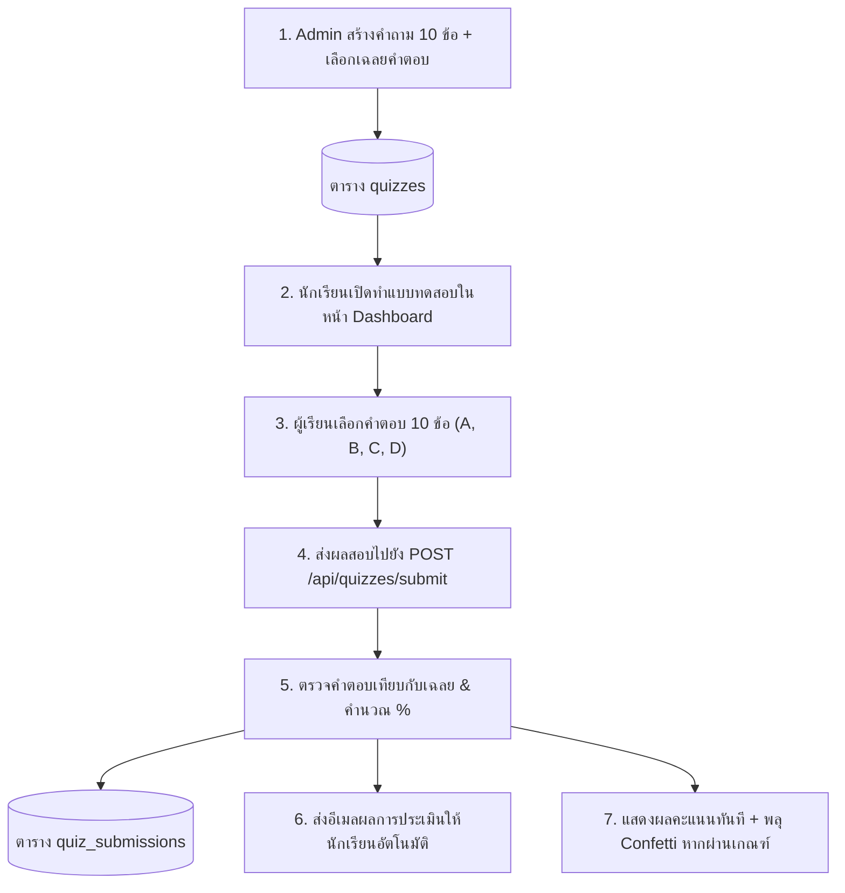

# ระบบประเมินและแบบทดสอบหลังเรียน (Student Evaluation & Quiz System)
## Post-Class Assessment, Grading, and Email Dispatch Specification

เอกสารนี้ระบุรายละเอียดโครงสร้างและขั้นตอนการทำงานของระบบประเมินผลและแบบทดสอบความรู้หลังเรียน (Quiz Evaluation System)

---

## 1. จุดประสงค์ของระบบ (Objective)

1. **ประเมินความรู้และความพึงพอใจ:** ให้ผู้เรียนได้ทดสอบความเข้าใจหลังจากเข้าร่วมคลาสหรือเวิร์กช็อป
2. **ตรวจและคิดคะแนนอัตโนมัติ:** แสดงคะแนนและผลประเมินทันทีแบบ Real-time พร้อมเอฟเฟกต์การแสดงความยินดี
3. **ส่งอีเมลแจ้งผลอัตโนมัติ:** ส่งรายงานสรุปคะแนนและใบรับรองผ่านอีเมลของผู้เรียน
4. **Admin จัดการชุดคำถามได้อย่างยืดหยุ่น:** ผู้สอนสามารถเพิ่ม ลบ หรือแก้ไขข้อสอบ 10 ข้อพร้อมเฉลยคำตอบที่ถูกต้องได้จากหน้า Admin

---

## 2. ขั้นตอนการทำงาน (Workflow)



---

## 3. โครงสร้างชุดข้อสอบและคำถาม (Question Format)

- **จำนวนคำถาม:** 10 ข้อต่อชุดประเมิน
- **รูปแบบตัวเลือก:** 4 ตัวเลือก (A, B, C, D)
- **การกำหนดเฉลย:** แอดมินระบุ `correctOptionIndex` (0 = ข้อ A, 1 = ข้อ B, 2 = ข้อ C, 3 = ข้อ D)
- **เกณฑ์การผ่าน (Passing Threshold):** มาตรฐานตั้งไว้ที่ **70%** (ตอบถูกอย่างน้อย 7 จาก 10 ข้อ)

### ตัวอย่างโครงสร้างคำถามในระบบ:
```typescript
{
  id: "q1",
  question: "Prompt Engineering เทคนิคใดที่ช่วยให้ AI คิดเป็นขั้นตอนอย่างมีเหตุผล?",
  options: [
    "Zero-shot Prompting",
    "Chain of Thought (CoT)",
    "Temperature Setting",
    "Few-shot Context"
  ],
  correctOptionIndex: 1, // ตอบ ข้อ 2 (Chain of Thought)
  explanation: "Chain of Thought ช่วยให้ LLM แสดงขั้นตอนการคิดทีละขั้นตอน ทำให้ความแม่นยำสูงขึ้น"
}
```

---

## 4. อีเมลแจ้งเตือนผลการประเมิน (Email Dispatch)

เมื่อนักเรียนส่งแบบทดสอบ ระบบจะจัดส่งอีเมลที่มีรายละเอียดดังนี้:
1. **หัวข้ออีเมล:** `สรุปผลการประเมินและแบบทดสอบ: [ชื่อคอร์ส/แบบประเมิน]`
2. **สถานะการประเมิน:**
   - **ผ่านเกณฑ์ (Passed):** ป้ายสีเขียวมรกต ยินดีด้วยคุณผ่านเกณฑ์การประเมินความรู้
   - **ไม่ผ่านเกณฑ์ (Review):** แนะนำหัวข้อที่ควรทบทวนเพิ่มเติม
3. **คะแนนที่ได้:** เช่น `8 / 10 คะแนน (80%)`
4. **เกณฑ์มาตรฐาน:** ผ่านที่ 70%

---

## 5. การจัดการของแอดมิน (Admin Features)

1. **สร้างและแก้ไขคำถาม:**
   - เข้าหน้า `Admin Portal > แบบประเมิน`
   - สามารถพิมพ์คำถามและช้อยส์ทั้ง 10 ข้อได้โดยตรง
   - คลิกเลือกช้อยส์ที่ถูกต้องได้ทันที
2. **ดูประวัติและผลสอบของนักเรียน:**
   - ตารางแสดงรายชื่อนักเรียน, วันที่ทำแบบทดสอบ, คะแนนที่ได้, และสถานะผ่าน/ไม่ผ่าน
3. **ส่งอีเมลผลสอบซ้ำ (Resend Email):**
   - แอดมินสามารถคลิกปุ่ม **"ส่งเมลซ้ำ"** ได้ตลอดเวลา เพื่อส่งผลประเมินไปยังอีเมลของนักเรียนอีกครั้ง
