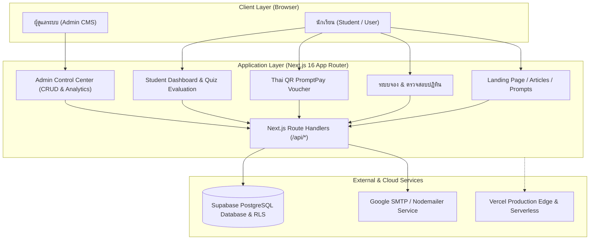
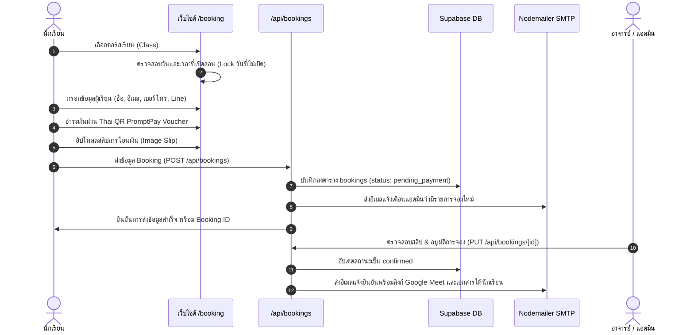
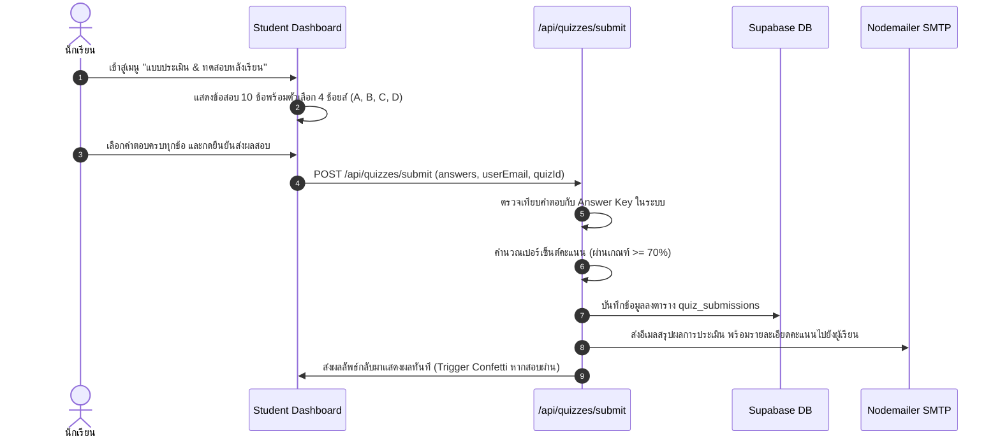

# สถาปัตยกรรมระบบ (System Architecture)
## AI Kevin Workshop & Private 1-on-1 Booking System

เอกสารนี้อธิบายโครงสร้างทางสถาปัตยกรรม (Architecture) แพลตฟอร์มการจองคอร์สเรียน อบรม AI สตูดิโอ และระบบประเมินผลหลังเรียน (CMS Booking System)

---

## 1. ภาพรวมระบบ (System Overview)

ระบบถูกออกแบบมาเป็น **Full-Stack Serverless Web Application** บน Next.js 16 App Router ร่วมกับ Supabase PostgreSQL ทำงานร่วมกับระบบชำระเงิน Thai QR PromptPay, ระบบจัดการปฏิทินคลาสเรียน, ระบบประเมินหลังเรียน และระบบแจ้งเตือนทางอีเมลอัตโนมัติ

---

## 2. เทคโนโลยีที่ใช้ (Tech Stack)

| ส่วนประกอบ | เทคโนโลยี | รายละเอียด |
| :--- | :--- | :--- |
| **Framework** | Next.js 16 (App Router) | Server Components, Turbopack, Dynamic Route Handlers |
| **UI Library** | React 19 + TypeScript 5 | Modern React Hooks, Concurrent Features, Strict Typing |
| **Styling** | Tailwind CSS v4 | CSS Variables, Dark/Modern Theme, Responsive Utility Classes |
| **Icons & Effects** | Lucide React + Canvas Confetti | Modern iconography & Celebration animation |
| **Database** | Supabase (PostgreSQL 15+) | Cloud Relational Database, Row Level Security (RLS) |
| **ORM / Client** | `@supabase/supabase-js` + SSR | Client-side & Server-side safe Supabase querying |
| **Email Service** | Nodemailer + Google SMTP | ส่งอีเมลแจ้งเตือนการจอง รหัสผ่าน และผลการประเมิน |
| **Deployment** | Vercel Serverless | Auto CI/CD, Edge CDN, Global Serverless Lambdas |

---

## 3. สถาปัตยกรรมความต่อเนื่องของข้อมูล (Data Resilience Architecture)

ระบบมีกลไกป้องกันการหยุดทำงานแบบ 2 ชั้น (**Two-Tier Data Resilience**):

1. **Primary Layer (Supabase PostgreSQL):**
   - บันทึกและดึงข้อมูลแบบ Real-time ข้ามอุปกรณ์และเครื่องของแอดมิน/นักเรียน
   - มี Row Level Security (RLS) ควบคุมความปลอดภัย
2. **Fallback Memory Store (Zero-Downtime Fallback):**
   - ในกรณีที่ Supabase Credential ยังไม่ได้ตั้งค่าหรือเครือข่ายมีปัญหา ระบบจะสลับไปใช้ In-Memory Store อัตโนมัติ ทำให้ผู้ใช้ยังสามารถทดสอบ UI, จองคลาส หรือทดลองทำแบบประเมินได้โดยไม่เกิดข้อผิดพลาด 500

---

## 4. แผนผังเส้นทางการทำงานของผู้ใช้ (User Flows)

### 4.1 การจองคลาสเรียน (Booking Journey)

### 4.2 ระบบประเมินและแบบทดสอบหลังเรียน (Quiz Evaluation Flow)

---

## 5. ความปลอดภัยและสิทธิ์การเข้าถึง (Security & Access Control)

1. **Authentication:**
   - รองรับการเข้าสู่ระบบด้วย Email/Password พร้อมตรวจสอบความปลอดภัยของรหัสผ่าน (ขั้นต่ำ 8 ตัวอักษร มีทั้งตัวอักษรและตัวเลข)
   - รองรับการเชื่อมต่อ Google OAuth
   - ระบบ Forgot Password พร้อมส่งรหัสผ่านชั่วคราวผ่านอีเมล
2. **Role-Based Access Control (RBAC):**
   - ผู้ใช้มี 2 บทบาท: `user` (นักเรียนทั่วไป) และ `admin` (ผู้ดูแลระบบ)
   - หน้า `/admin` ตรวจสอบสถานะบทบาทจาก Auth Token และ User Context หากไม่ใช่แอดมินจะถูกปฏิเสธการเข้าถึง
3. **Data Sanitization & Anti-Spam:**
   - มีการตรวจสอบความถี่ของการส่งคำขอ (Debounce & Rate Limiting)
   - ป้องกันการกดยืนยันการจองซ้ำซ้อน (Deduplication Check)
